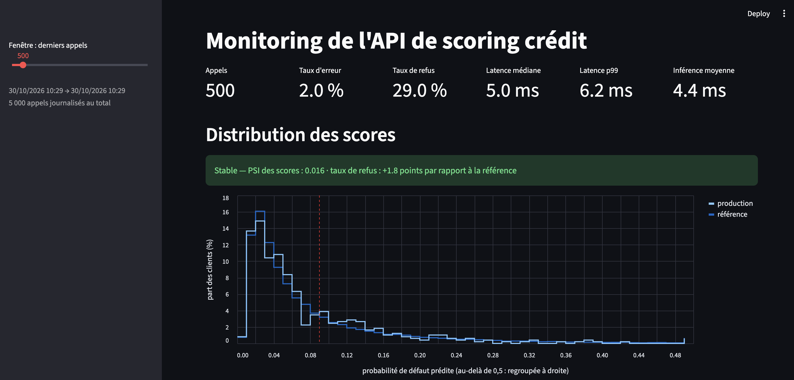
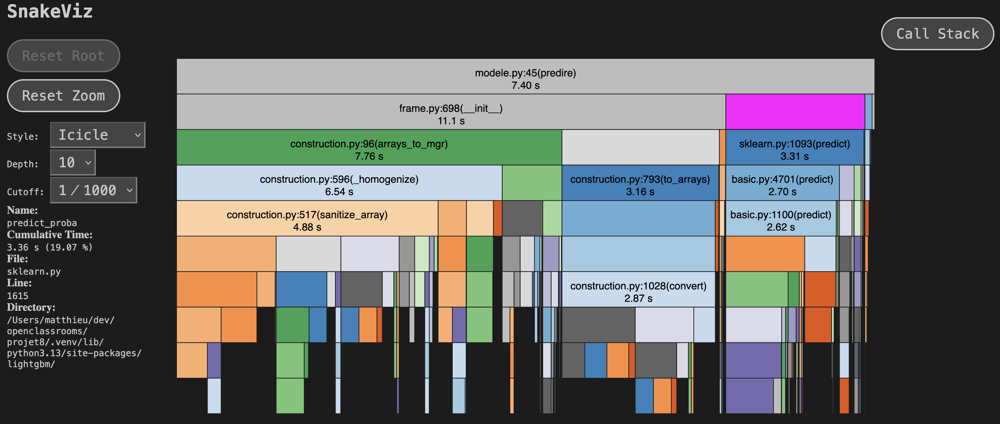
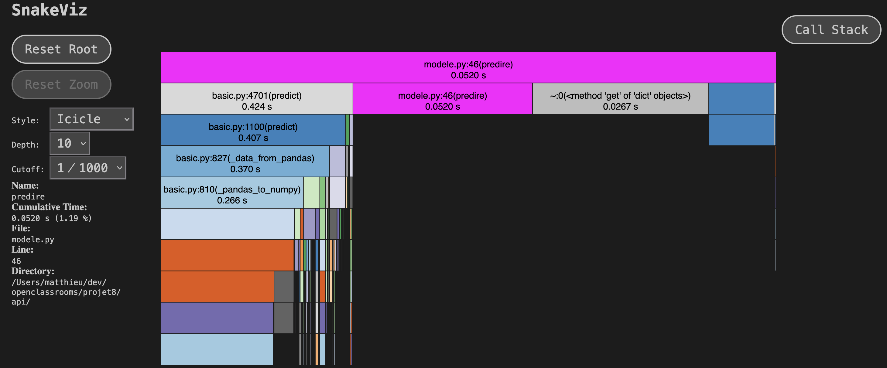

# Scoring crédit — mise en production et monitoring

Projet 8 du parcours OpenClassrooms : *Confirmez vos compétences en MLOps (partie 2/2)*.

« Prêt à Dépenser » dispose d'un modèle de scoring crédit, entraîné et versionné dans le
[projet 6](https://github.com/matthieudevivie/projet-6---Initiez-vous-au-ML-Ops---partie-1).
Ce dépôt le met en production : API, conteneur Docker, pipeline CI/CD, puis stockage des
données de production et suivi de la dérive des données.

**En production** : https://scoring-credit.onrender.com (documentation interactive sur `/docs`).
L'offre gratuite de Render met le service en veille : le premier appel peut prendre une minute.

## Le modèle

| | |
|---|---|
| Modèle | `scoring_credit_lgbm`, version 10 du registre MLflow (alias `champion`) |
| Algorithme | LightGBM (`LGBMClassifier`) |
| Entrées | 800 variables issues des tables Home Credit (184 obligatoires, les autres peuvent être manquantes) |
| Sortie | Probabilité de défaut de paiement |
| Décision | Crédit refusé si la probabilité est ≥ **0,09** (seuil minimisant le coût métier) |

Les fichiers du modèle sont dans [`model/`](model/), avec leurs métadonnées dans
[`model/metadata.json`](model/metadata.json). Ils sont copiés à l'identique depuis le registre
MLflow du projet 6 : l'empreinte SHA-256 de `model.pkl` y est consignée.

## Environnement

Le modèle a été sérialisé sous Python 3.13 avec des versions précises de scikit-learn, LightGBM
et pandas. Le projet reprend **exactement ces versions** (voir `pyproject.toml`) : charger un
modèle avec d'autres versions peut produire des erreurs ou des prédictions différentes.

```bash
uv sync
```

## Lancer l'API

**En local**, avec la journalisation des appels dans une base SQLite :

```bash
mkdir -p logs
DATABASE_URL=sqlite:///logs/appels.db uv run uvicorn api.main:app --port 8000
```

Sans `DATABASE_URL`, l'API fonctionne aussi, mais n'écrit les appels que dans ses logs (au format JSON).

**Avec Docker**, comme en production :

```bash
docker build -t scoring-credit .
docker run --rm -p 7860:7860 scoring-credit
```

| Route | Rôle |
|---|---|
| `GET /docs` | Documentation interactive (la racine `/` y renvoie) |
| `GET /health` | État du service, modèle chargé et commit déployé |
| `POST /predict` | Probabilité de défaut et décision pour un client (paramètre `id_client` facultatif, pour le suivi) |
| `GET /drift` | Dernier rapport de data drift (Evidently) |

Exemple d'appel, avec le premier client d'exemple enregistré par MLflow :

```bash
uv run python -c "
import json, math
e = json.load(open('model/input_example.json'))
client = dict(zip(e['columns'], e['data'][0]))
print(json.dumps({k: None if isinstance(v, float) and math.isnan(v) else v for k, v in client.items()}))
" > client.json
curl -X POST "localhost:8000/predict?id_client=100001" -H "Content-Type: application/json" -d @client.json
# {"probabilite_defaut":0.0487,"decision":"accorde","seuil":0.09,"version_modele":10}
```

## Tests et CI/CD

```bash
uv run pytest
```

Le pipeline [`.github/workflows/ci.yml`](.github/workflows/ci.yml) tourne sur chaque pull request
et sur chaque push dans `main` :

1. **tests** : qualité du code (ruff, pylint ≥ 9,5), puis la suite pytest avec la couverture ;
2. **image** : construction de l'image Docker, démarrage du conteneur, vérification de `/health` et de `/drift` ;
3. sur `main` seulement : publication de l'image sur `ghcr.io`, puis **deploy** sur Render, et
   attente que `/health` renvoie le commit qui vient d'être déployé.

## Stockage des données de production

Chaque appel à `/predict`, réussi ou refusé, est enregistré par un middleware de l'API
([`api/journal.py`](api/journal.py)) : une ligne JSON dans les logs, et une ligne dans la table
`appels` si une base est configurée.

| Colonne | Contenu |
|---|---|
| `date_appel`, `id_client` | Quand, et pour quel client |
| `statut_http` | 200 réussi, 422 refusé par la validation, 500 panne |
| `duree_ms`, `duree_inference_ms` | Latence totale de l'API, et temps du seul modèle |
| `probabilite_defaut`, `decision`, `seuil`, `version_modele` | La réponse renvoyée |
| `entrees` | Les 12 variables surveillées (JSON) : les 10 plus importantes du modèle, plus 2 variables 0/1 |
| `erreur` | La raison d'un refus ou d'une panne (JSON) |

Captures de la base : [structure](captures/stockage_1_structure.png),
[données](captures/stockage_2_donnees.png), [requête de suivi](captures/stockage_3_requete.png).

**Choix et limites.** La base est un fichier SQLite local, alimenté par une simulation de
production : 5 000 clients de `application_test` envoyés à l'API locale
([`scripts/simuler_production.py`](scripts/simuler_production.py)). Sur Render, le disque est
effacé à chaque redémarrage : l'API n'y écrit que ses logs JSON. En production réelle, la même
table irait dans une base hébergée (PostgreSQL managé, par exemple) : il suffit de changer
`DATABASE_URL`, le code ne change pas.

**Volume et coût.** Environ 500 octets par appel (2,5 Mo pour 5 000 appels), dont les trois quarts
pour `entrees`. Un million d'appels représente donc environ 500 Mo. C'est pour cela qu'on ne
journalise que les 12 variables surveillées, et pas les 800 : le volume serait environ 60 fois plus
grand. Au-delà de la durée de conservation, les lignes seraient supprimées ou agrégées
(statistiques par jour).

**RGPD.** Ces données concernent des personnes : `id_client` est un identifiant pseudonyme, qui
reste une donnée personnelle, et `entrees` contient l'âge (`DAYS_BIRTH`) et le sexe
(`CODE_GENDER_F`). Les principes appliqués :
- **minimisation** : 12 variables sur 800, et jamais la valeur refusée d'une requête invalide ;
- **finalité** : uniquement la surveillance du modèle (dérive, erreurs, latence) ;
- **conservation limitée** : durée à fixer avec le DPO. L'analyse n'a besoin que d'une fenêtre
  récente et d'une référence, et les statistiques agrégées peuvent être gardées sans les lignes ;
- **accès restreint** à l'équipe data. Les fichiers `logs/` et `data/` ne sont pas versionnés.

## Monitoring : lire l'analyse du drift

L'analyse se trouve dans [`notebooks/analyse_drift.ipynb`](notebooks/analyse_drift.ipynb). Elle
compare les appels journalisés aux données d'entraînement (la référence) sur les 12 variables
surveillées : tests statistiques (KS pour les variables numériques, χ² pour les variables 0/1),
PSI, visualisations, sortie du modèle, erreurs et latence, puis suivi par fenêtres de 500 appels.
Elle produit le rapport Evidently [`rapports/rapport_drift.html`](rapports/rapport_drift.html),
servi par l'API sur [`/drift`](https://scoring-credit.onrender.com/drift).

Pour la relancer (les données brutes Kaggle doivent être dans `../projet6/data`) :

```bash
uv run python scripts/preparer_donnees.py                    # data/reference.parquet et data/production.parquet
# l'API locale lancée avec DATABASE_URL (voir plus haut), puis :
uv run python scripts/simuler_production.py --clients 5000   # remplit logs/appels.db
```

puis exécuter le notebook.

**Lire le rapport `/drift`.** Le haut de page donne le nombre de variables en dérive. Evidently ne
conclut à une dérive globale que si la moitié des variables dérivent. Ce seuil est trop tolérant
ici : les 12 variables ont été choisies pour leur importance, et une seule suffit à justifier une
vérification. Le tableau détaille ensuite chaque variable : test utilisé, score, et distribution
de la référence comparée à celle de la production.

**Règle d'alerte retenue** (calculée sur une fenêtre des 500 derniers appels) :

| Niveau | Déclencheur |
|---|---|
| **Alerte** | une variable avec PSI > 0,25 · un écart de valeurs manquantes > 10 points · PSI des probabilités prédites > 0,1 ou taux de refus qui varie de plus de 5 points |
| **À surveiller** | PSI entre 0,1 et 0,25 · distance de Wasserstein normalisée > 0,1 |

**Résultat sur la simulation.** Deux variables sur 12 ont dérivé : `PAYMENT_RATE` (PSI 1,47, des
crédits plus courts) et `EXT_SOURCE_1` (13,6 points de valeurs manquantes en moins). Les décisions
n'ont pas changé : le PSI des scores est de 0,007, et le taux de refus passe de 27,2 % à 25,9 %.
L'API fonctionne normalement : 1,8 % d'erreurs, toutes des 422 attendues, et une latence p99 de
6,9 ms. Le modèle peut donc rester en production, sous surveillance. Le plan d'action est détaillé
à la fin du notebook.

## Tableau de bord

```bash
uv run streamlit run dashboard/app.py
```

Il lit les appels journalisés (`logs/appels.db`) et les compare aux données d'entraînement
(`data/reference.parquet`) : il tourne donc en local, à côté de la base. Le curseur choisit la
fenêtre analysée (les 500 derniers appels par défaut, la taille retenue dans le notebook).

| Partie | Ce qu'elle montre |
|---|---|
| Indicateurs clés | Nombre d'appels, taux d'erreur, taux de refus, latence médiane et p99, temps d'inférence moyen |
| Distribution des scores | Scores de production et de référence, seuil de décision, PSI des scores et variation du taux de refus |
| Temps de réponse | Latence totale et temps d'inférence au fil des appels, répartition des statuts HTTP |
| Dérive des variables | PSI et écart de valeurs manquantes des 12 variables surveillées, colorés selon la règle d'alerte |



Les calculs sont dans [`dashboard/indicateurs.py`](dashboard/indicateurs.py), testés par
[`tests/test_indicateurs.py`](tests/test_indicateurs.py) ; l'affichage dans [`dashboard/app.py`](dashboard/app.py).

## Optimisation des performances

Démarche : **mesurer → localiser → optimiser → vérifier → déployer**. Chaque hypothèse part des données
de monitoring, est confirmée par un profiler, et chaque gain est mesuré à nouveau par le monitoring.

### Le goulot d'étranglement

Le monitoring de l'API montrait que l'inférence représentait **86 %** de la durée d'un appel. Le profiling
(`cProfile` + `snakeviz`) a précisé où partait ce temps dans `predire()` :

| Étape de `predire()` | Part du temps |
|---|---|
| Construction d'un `DataFrame` pandas de 800 colonnes pour un seul client | **79 %** |
| `predict_proba` (vérifications scikit-learn, conversion des données) | 20 % |
| Calcul des 400 arbres par LightGBM (C++) | ≈ 1 % |

Le modèle n'était donc pas le goulot : c'était la préparation des données.

| Avant | Après |
|---|---|
|  |  |

### L'optimisation retenue : numpy au lieu de pandas

`predire()` construit directement un tableau numpy, dans l'ordre des variables du modèle, et appelle le
booster LightGBM sans passer par la couche scikit-learn. Aucune nouvelle dépendance.

```bash
uv run python -m scripts.mesure_latence   # banc d'essai : un client, 300 répétitions
```

| Mesure (médiane) | Avant | Après | Gain |
|---|---|---|---|
| `predire()` au banc d'essai | 4,4 ms | 0,073 ms | ÷ 60 |
| Temps d'inférence (monitoring, p95) | 4,34 ms (4,98) | 0,118 ms (0,144) | ÷ 37 |
| Durée totale de l'appel (monitoring, p95) | 5,05 ms (5,88) | 0,681 ms (0,754) | ÷ 7,4 |
| Part de l'inférence dans l'appel | 86 % | 17 % | |

*Monitoring : 4 912 prédictions avant, 980 après, API locale, base SQLite séparée pour chaque série.*

**Non-régression** : le test `test_predire_identique_a_scikit_learn` vérifie que les probabilités sont
identiques à l'ancienne méthode à 10⁻¹² près ; les 45 tests passent, donc aucune décision ne change.

Après l'optimisation, **le goulot s'est déplacé** : l'essentiel de l'appel est désormais la validation
Pydantic des 800 champs. À 0,7 ms par appel, l'alléger n'apporterait rien de visible face à la latence réseau.

### Stratégies testées et écartées

| Stratégie | Résultat | Décision |
|---|---|---|
| **ONNX Runtime** ([`scripts/comparer_onnx.py`](scripts/comparer_onnx.py)) | 0,043 ms contre 0,075 ms par prédiction, mais probabilités non strictement identiques (float32) : écart max 0,0028 sur 50 000 clients, 0 décision modifiée | **Écartée** : gain de 0,03 ms (4 % de l'appel) contre une dépendance en plus et la perte de l'identité stricte avec le modèle validé |
| **Quantification** | Conçue pour les poids des réseaux de neurones ; un modèle d'arbres n'a pas de poids à quantifier | **Inadaptée** |
| **Moins d'arbres** (≈ 342 au lieu de 400) | Accélérerait l'inférence, mais change le modèle | **Hors périmètre** : c'est un réentraînement à revalider |

### Hardware

| Mesure | Résultat |
|---|---|
| Réveil de l'instance Render gratuite (*cold start*, après 15 min sans appel) | 0.121 s |
| Appel suivant | 0.117 s |

L'inférence ne coûte plus que 0,1 ms : un processeur plus puissant n'apporterait presque rien. Le temps perçu
vient du réseau et du réveil de l'instance. Pistes : instance toujours active (supprime le cold start),
plusieurs workers uvicorn si la charge augmente. Un GPU est inutile pour un modèle d'arbres.

### Configuration finale

LightGBM natif appelé avec numpy, sur l'instance CPU gratuite de Render, sans dépendance d'optimisation
supplémentaire. Limite assumée : le cold start, qui disparaîtrait avec une instance payante toujours active.

### Qualité du code

Vérifiée à chaque pull request par la CI : `ruff check` (analyse statique), `ruff format --check` (style
black), `pylint --fail-under=9.5`, et la couverture de test.

| Indicateur | Avant | Après |
|---|---|---|
| Note pylint (`api`, `dashboard`, `scripts`) | 7,90/10 | 10,00/10 |
| Remarques ruff | 7 | 0 |
| Fichiers non formatés | 15 | 0 |
| Couverture de test | API 100 % | 99 % au total, API 100 % |
| Complexité moyenne (radon) | A | A |

Les rares exceptions aux règles sont écrites et justifiées dans [`pyproject.toml`](pyproject.toml).


## Avancement

- [x] Étape 1 — Dépôt Git et structure du projet
- [x] Étape 2 — API, tests, Docker et pipeline CI/CD
- [x] Étape 3 — Stockage des données de production et analyse du drift
- [ ] Étape 4 — Analyse et optimisation des performances
